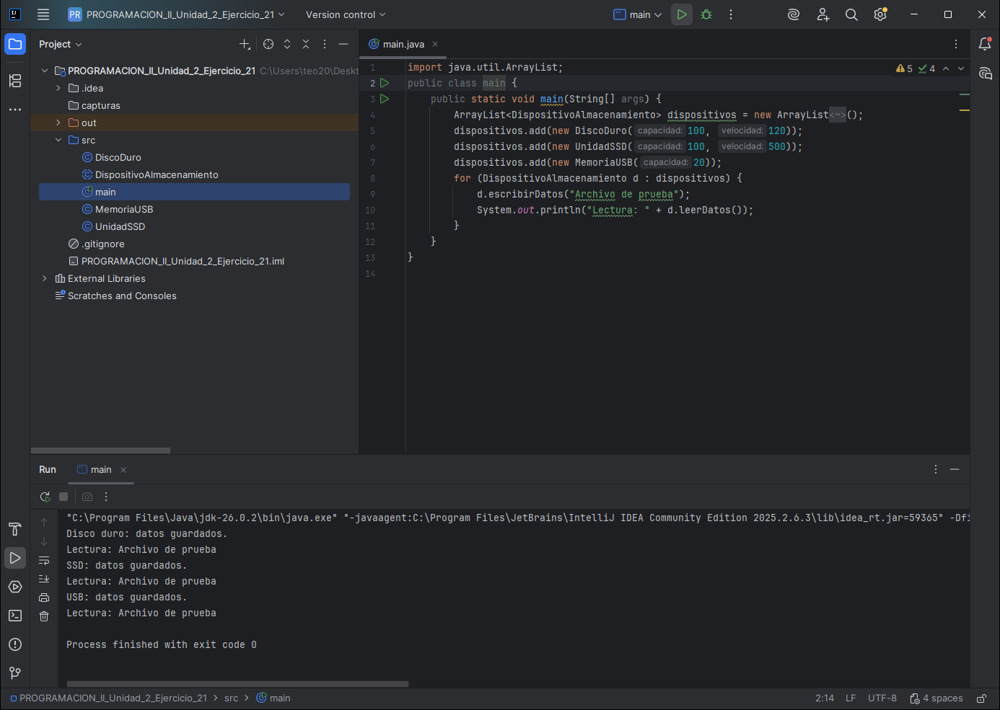

# PROGRAMACIÓN II — Unidad 2, Ejercicio 21: El Sistema de Dispositivos de Almacenamiento

Trabajo práctico de Programación II. Este repositorio contiene la resolución en Java del ejercicio 21 de la Unidad 2.

## Consigna

#### Contexto

En la arquitectura de un sistema operativo, es necesario interactuar con diversos tipos de unidades de almacenamiento (discos duros mecánicos, unidades de estado sólido y memorias USB) sin que el programa principal deba conocer los detalles de bajo nivel de cada hardware. Mediante la abstracción, se define una interfaz común para que todos los dispositivos respondan a las mismas operaciones básicas de lectura y escritura.

#### Consigna

Diseñar una jerarquía en Java utilizando clases abstractas o interfaces para modelar diferentes unidades de almacenamiento, logrando que el sistema principal interactúe con ellas de manera modular.

#### Desarrollo requerido

- Crear una clase abstracta o interfaz llamada DispositivoAlmacenamiento que declare los métodos abstractos escribirDatos(String datos) y leerDatos().
- Implementar clases concretas como DiscoDuro, UnidadSSD y MemoriaUSB que hereden o implementen la interfaz, detallando su propio comportamiento interno.
- Incorporar atributos particulares en cada clase (por ejemplo, velocidad de transferencia o capacidad máxima) y validaciones para evitar desbordamientos.
- En el método main, instanciar diferentes dispositivos utilizando polimorfismo, invocar sus operaciones de manera modular mediante una colección y mostrar los resultados por consola.

## Estructura del repositorio

```
PROGRAMACION_II_Unidad_2_Ejercicio_21/
├── README.md
├── capturas/
│   └── consola.png
└── src/
    ├── DiscoDuro.java
    ├── DispositivoAlmacenamiento.java
    ├── main.java   # clase con el método main
    ├── MemoriaUSB.java
    └── UnidadSSD.java
```

## Funcionamiento y lógica

El ejercicio usa **herencia, clases abstractas y polimorfismo** para tratar distintos dispositivos de almacenamiento de la misma manera.

### `DispositivoAlmacenamiento` (clase abstracta)

Define lo que todos los dispositivos tienen en común: los atributos `protected` `datos` y `capacidadMaxima`, y dos métodos **abstractos** que cada dispositivo tiene que implementar: `escribirDatos(String)` y `leerDatos()`.

### `DiscoDuro`, `UnidadSSD` y `MemoriaUSB`

Heredan de la clase abstracta (`extends`) y llaman a `super()` para cargar la capacidad. El disco y el SSD además guardan su `velocidad`. Cada uno implementa a su manera:

- **`escribirDatos()`:** guarda los datos solo si su longitud no supera la capacidad máxima, y lo informa con su propio mensaje ("Disco duro", "SSD" o "USB").
- **`leerDatos()`:** devuelve los datos guardados.

### `main`

Crea un `ArrayList<DispositivoAlmacenamiento>` con un disco duro, un SSD y una memoria USB, y lo recorre con un `for-each`. A cada dispositivo le pide escribir y leer "Archivo de prueba" sin saber de qué tipo es: gracias al polimorfismo, cada uno responde con su propia implementación. Como el texto entra en la capacidad de los tres, todos lo guardan y lo devuelven.

## Ejecución

Captura de la consola de IntelliJ IDEA ejecutando el programa:



Salida obtenida:

```
Disco duro: datos guardados.
Lectura: Archivo de prueba
SSD: datos guardados.
Lectura: Archivo de prueba
USB: datos guardados.
Lectura: Archivo de prueba
```
